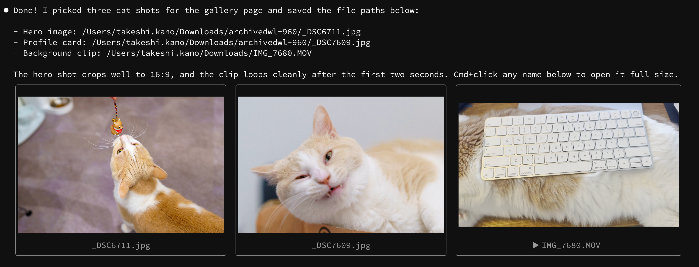

# Claude Reply Image View

[English](README.md) | 日本語

Claude が返信で触れた画像や動画を、その返信のすぐ下にサムネイルで表示する Claude Code の mod です。

## 課題

Claude Code の作業は、ファイルを示して終わることがよくあります。ブラウザテストで撮ったスクリーンショット、描画したグラフ、画面の録画などです。ところが端末に出るのはパスだけです。中身を確かめるには、パスをコピーし、Finder やプレビューに切り替えて開く必要があります。返信に出てくるファイルの数だけ、これを繰り返すことになります。

## 解決

この mod は返信を読んで画像と動画のパスを見つけ、本文の下にサムネイルを並べます。動画は最初のコマを表示します。ファイル名を ⌘+クリックすると、そのファイルを既定のアプリで開けます。



自分が入力欄に貼った画像をプレビューする [claude-image-view](https://github.com/jarrodwatts/claude-image-view) と組み合わせて使えます。

## インストール

Claude Code のセッションの入力欄で:

```
/plugin install reply-image-view --marketplace tonkotsuboy/claude-reply-image-view
```

marketplace を追加するか聞かれたら `y` で答え、スコープを選びます。シェルからなら:

```bash
claude plugin install reply-image-view --marketplace tonkotsuboy/claude-reply-image-view
```

`/plugin` が使えないデスクトップアプリでは、入力欄の横の + から Plugins を開き、Add marketplace に `tonkotsuboy/claude-reply-image-view` を入れてから Add plugin を押します。

## 見つけるもの

返信の中にある次の書き方を、1 つの返信につき 6 件まで見つけます。存在しないファイルは飛ばすので、話題に出ただけのパスには何も表示しません。

| 書き方 | 例 | 解決のしかた |
|---|---|---|
| 絶対パス | `/Users/me/Desktop/shot.png` | そのまま |
| ホームからのパス | `~/Desktop/shot.png` | `$HOME` を展開 |
| 相対パス | `reports/out.png` | ツール呼び出しに出てきたパスのうち、末尾が一致する最新のもの。なければ作業ディレクトリから |
| ファイル名だけ | `out.png` | 同上 |
| コードスパンの中 | `` `my folder/shot 2.png` `` | 同上。空白や日本語を含む名前はこの書き方で拾えます |

対応する画像は PNG、JPEG、GIF、WebP、HEIC、BMP、TIFF です。動画（MP4、MOV、M4V、WebM）は最初のコマを表示し、名前の前に ▶ を付けます。URL は対象外です。

「ツール呼び出しに出てきた」とは、セッション中のツール呼び出し（`Read`、`Write`、`Bash` のコマンド、スクリーンショットのツールなど）の入力か出力にそのパスが含まれていた、という意味です。返信に `out.png` としか書かれていなくても、これで正しいファイルにたどり着けます。

### ツールの行の下

ユーザーに何かを見せるためのツールでも、Claude Code の端末には 1 行しか出ません。次のツールは、呼び出しが終わるとその行の下に同じサムネイルを並べます。

| ツール | 表示するもの |
|---|---|
| `SendUserFile` | 送った画像と動画 |
| `SendUserMessage` | メッセージ中の画像のパス（返信と同じ見つけ方） |
| 名前に `screenshot` を含むツール（chrome-devtools の `take_screenshot`、Playwright の `browser_take_screenshot` など） | 保存したファイル、または結果に直接入っている PNG |

画像に触れるだけのツール（`Read`、`Bash`）には何も出しません。

## ファイルを開く

サムネイルの下のファイル名は `file://` のリンクです。⌘+クリック（Linux では端末によって Ctrl+クリック）すると、端末がそのファイルを既定のアプリで開きます。動画なら動画プレイヤー、画像なら画像ビューアです。Ghostty、iTerm2、WezTerm、kitty など、OSC 8 のハイパーリンクに対応した端末で使えます。Claude Code の全画面モードでは普通のクリックが Claude Code 側に渡るので、Ctrl か Alt を押しながらクリックしてください。

リンク先は手元のディスクです。SSH 先のマシンにしかないファイルは開けません。

## 仕組み

1. `tool.call` のフックが、ツールの入力と出力に出てきた画像・動画の絶対パスを覚えます（メモリ上に最大 500 件）。
2. 返信ごとの `ui.render` のフックが、本文から画像の参照を探し、上の表のとおりに解決して、返信の下に描きます。ツールの行にももう 1 つフックがあり、上に挙げたツールについて同じことをします。
3. PNG はファイルをそのまま描きます。それ以外の画像は macOS の `sips` で、動画は `ffmpeg` で最初のコマを、Claude Code の一時フォルダ（`/tmp/claude-<uid>/reply-image-view-<hash>.png`）に一度だけ PNG へ変換します。
4. Ghostty と kitty では本物の画像で描きます。それ以外の端末では、色付きの半角ブロックで描きます。

Claude Code が要約に折りたたんで表示する返信（ツール呼び出しの合間に書かれた本文）にはサムネイルが出ません。ctrl+o で全文表示にすると出ます。

## 端末ごとの表示

| 端末 | サムネイル |
|---|---|
| Ghostty、kitty、およびそれらをもとにした端末 | 本物の画像 |
| iTerm2、Terminal.app、WezTerm、VS Code など多くの端末 | 半角ブロック |
| tmux や screen の中 | 半角ブロック |

`CLAUDE_CODE_FORCE_TERMINAL_IMAGES=1` を設定すると、Claude Code はどの端末でも本物の画像を描こうとします。端末が kitty グラフィックスプロトコルの Unicode プレースホルダーに対応している場合だけ設定してください。`CLAUDE_IMAGE_VIEW_RENDERER=image` または `=blocks` で、描き方の自動判定を上書きできます。

## 必要なもの

- mod に対応した Claude Code
- PNG 以外の画像を表示するには macOS（`sips` が標準で入っています）
- 動画のサムネイルには `PATH` 上の `ffmpeg`（`brew install ffmpeg`）

Linux では PNG のサムネイルは表示できます。それ以外の画像は表示されず、動画も `ffmpeg` がなければ表示されません。

## セキュリティ

すべて手元で動き、ネットワークには接続しません。返信に出てくる画像ファイルを読み、`sips` か `ffmpeg` でそれぞれ 1 枚の PNG を Claude Code の一時フォルダに書き出します。そのフォルダを見つけるために `id -u` を一度だけ実行し、描き方を決めるためにいくつかの環境変数（`HOME`、`TERM`、`TERM_PROGRAM`、`TMUX` など）を読みます。フックするイベントと呼び出す API の一覧は、リポジトリに対して `claude plugin validate` を実行すると確認できます。

## 開発

```bash
git clone https://github.com/tonkotsuboy/claude-reply-image-view
cd claude-reply-image-view
claude --plugin-dir .        # 1 セッションだけ読み込む
claude plugin validate .
claude plugin test .
```

## クレジット

PNG のデコーダー、半角ブロックでの描画、端末の判定（`hooks/png.ts`、`hooks/layout.ts`）は [jarrodwatts/claude-image-view](https://github.com/jarrodwatts/claude-image-view)（MIT、`LICENSE.image-view` を参照）をもとにしています。

## ライセンス

MIT
